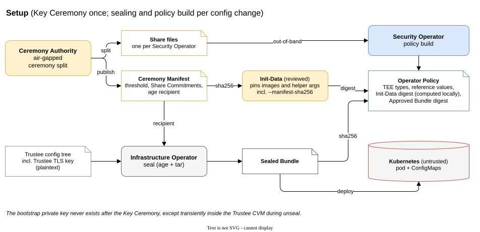
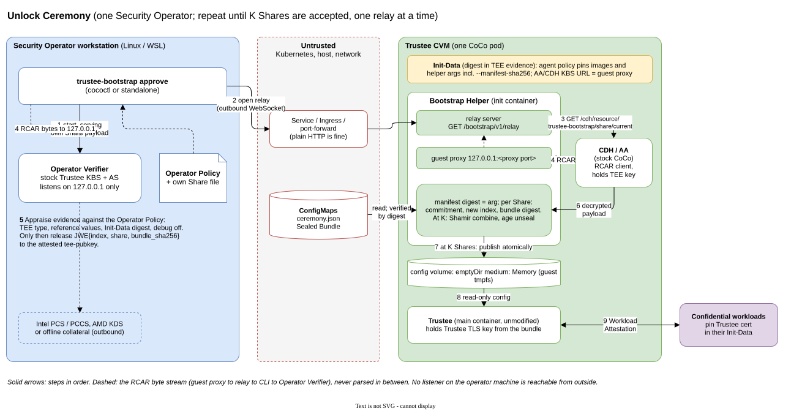
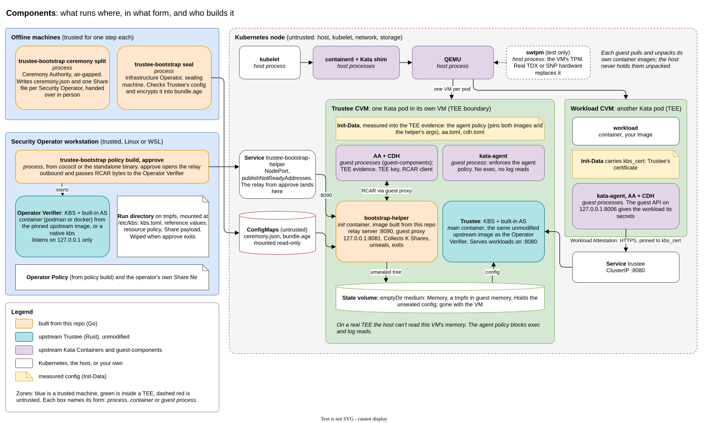

# Trustee-in-CVM: Implementation Specification

**Status:** Phases 0 to 2 implemented on swtpm and green in CI; Phase 3's real-TEE release gate (ticket 17) is open. No production unlock until it passes. §9 ticks each item and names the ticket that holds the evidence; [`docs/tickets/`](docs/tickets/README.md) has the full status.  
**Version:** v1.1 | **Date:** 2026-11-12  
**Companions:** `SECURITY_THREAT_MODEL.md`, `GLOSSARY.md`, `docs/adr/`

Terms in **bold** are defined in `GLOSSARY.md`. Design rationale lives in the ADRs and is not repeated here.







Diagram source: `docs/diagrams/trustee-bootstrap.drawio` (page 1 is the Unlock Ceremony, page 2 is Setup, page 3 is Components). The SVGs embed the diagram, so any of these files opens in draw.io for editing.

## 0. Mission and constraints

Unlock an unmodified, full CNCF Trustee running in a **Trustee CVM** only after K-of-N **Security Operators** have each independently appraised that CVM and released their **Share** to it. Each Security Operator runs an **Operator Verifier**: a stock Trustee KBS with its built-in AS, on their own workstation and bound to `127.0.0.1`. The Operator Verifier reaches the CVM through a tunnel that the operator's CLI opens outbound. Inside the CVM, a **Bootstrap Helper** init container collects the Shares, reconstructs the bootstrap private key, unseals the **Sealed Bundle** into guest memory, and exits so that Trustee can start.

### Non-negotiable requirements

1. Reuse Trustee's RCAR protocol, verifier, attestation token and JWE resource delivery unchanged. The Bootstrap Helper gets attestation only through the sandbox's CDH/AA. Do not write a parallel attestation protocol or custom crypto.
2. The Operator Verifier listens only on `127.0.0.1`. Every network connection across hosts is initiated by the CLI.
3. A Share leaves the operator's machine only as a JWE to the attested TEE key, and only after the appraisal succeeds.
4. The Bootstrap Helper accepts a Share only if `sha256(share)` matches its **Share Commitment** (ADR 0003). It unseals only the **Approved Bundle** that every accepted Share names (ADR 0004).
5. The **Ceremony Manifest** is trusted only if its digest equals the digest pinned in the Bootstrap Helper's container args, which Init-Data measures (ADR 0007).
6. Plaintext config, Shares and the reconstructed key never reach host-visible storage, logs, env, Kubernetes objects or API responses.
7. Pin every upstream version or digest. Fail closed whenever any check can't be performed.

## 1. Two uses of attestation

- **Bootstrap Attestation**: each Operator Verifier appraises the Trustee CVM: the TEE evidence, the Init-Data digest, and through Init-Data the Kata Agent policy, image digests and the Ceremony Manifest digest.
- **Workload Attestation**: the unlocked Trustee appraises other confidential workloads in normal service.

**How workloads trust Trustee:** Trustee's TLS private key exists only inside the Sealed Bundle, once the Infrastructure Operator has destroyed the plaintext they sealed it from (ADR 0008). Workloads add Trustee's certificate (`kbs_cert`) to their own Init-Data. Rotating Trustee's certificate means sealing a new bundle and updating every workload's Init-Data.

`kbs_cert` *adds* a trust root; the guest keeps trusting its system CAs. So Trustee's certificate must name a host that no public CA will certify: a cluster-internal DNS name or a private IP. Sealed-config check 4 (§3) refuses any other name. Otherwise anyone holding a publicly trusted certificate for that name can impersonate Trustee to workloads. An impostor still can't obtain workload secrets, but it can serve workloads fake resources. *(Phase 0 result: guest-components v0.22.0 can't. Ticket 06 records the upstream gap and the smallest fix.)*

## 2. Actors

| Actor | Where | Trusted for |
|---|---|---|
| **Ceremony Authority** | Air-gapped machine, once per Key Ceremony | Generating the key pair, splitting it into Shares, and retiring the private key |
| **Security Operator** | Own Linux/WSL workstation | Their own Share, and their own Operator Policy |
| **Infrastructure Operator** | Controlled sealing machine | Authoring the plaintext config, sealing it, and destroying the plaintext afterwards (ADR 0008). Never holds a Share |
| Kubernetes, host and network | — | Nothing. May drop, replay, reorder or substitute anything |
| **Bootstrap Helper** | Init container in the Trustee CVM | Only once Bootstrap Attestation has verified it |
| CDH/AA | Trustee CVM sandbox (stock CoCo) | RCAR client; holds the TEE key |
| Trustee | Main container in the Trustee CVM | Normal service after unlock (unmodified) |

## 3. Artifacts

All formats are owned by one Go module in this repo (ADR 0001, ADR 0006).

1. **Bootstrap key pair**: an age X25519 identity and its recipient. The identity's bytes are split with `github.com/hashicorp/vault/shamir`.
2. **Ceremony Manifest** (`ceremony.json`, public and unsigned):
   ```json
   {"version":1,"key_id":"…","threshold":2,"recipient":"age1…",
    "shares":[{"index":1,"holder":"alice","commitment":"sha256:…"}, …]}
   ```
   - `index` is the position in this list, and `holder` is a label for audit only.
   - The Bootstrap Helper rejects the manifest if indices or commitments repeat, if `threshold < 2`, or if `threshold > len(shares)`.
3. **Share file** (one per Security Operator, `0600`): `{"version":1,"key_id":"…","index":1,"share":"<base64 Vault part>"}`.
4. **Sealed Bundle**: `age -r <recipient>` over a tar of Trustee's config tree. Paths are relative to Trustee's config root.
   - It contains the KBS config, resource policy, RVPS reference values, resources, admin public key, the AS token signer key and certificate, and Trustee's TLS key and certificate.
   - Its digest is `sha256` of the sealed file's bytes.
   - It is Trustee's **entire** state (ADR 0002).
   - Size cap: 1 MiB, because it travels in a ConfigMap or Secret.
   - **Sealed-config checks.** `seal` runs these before encrypting. The Bootstrap Helper runs them again before publishing, because a bundle sealed with stock `age` skipped them. Any failure stops publication.
     1. The KBS config sets `insecure_header_jwk = false` and `insecure_http = false`, and admin authorization isn't `InsecureAllowAll`.
     2. The AS token broker names a signer key and certificate that exist in the tree, and KBS `trusted_certs_paths` lists that certificate. Without this, KBS can't verify any token and serves nothing.
     3. The KBS resource policy exists at the storage backend's exact policy key, is non-empty, and differs from upstream's built-in default. If it's missing, KBS installs that default, which releases every resource to any attested non-sample TEE.
     4. The HTTPS key and certificate that `[http_server]` names exist in the tree and match. The certificate is a leaf, not a CA, and it names at least one host. Every name it carries is cluster-internal: a DNS name under `.svc`, `.local` or `.internal`, or a private IP address (RFC 1918 or IPv6 ULA). Workloads pin it as `kbs_cert` on top of their system CAs (§1), so a name that a public CA would certify lets that CA's customers impersonate Trustee. The guest's rustls refuses a CA certificate as a server's own. *(Ticket 18.)*
5. **Share payload**: the plaintext of the KBS resource that the Operator Verifier serves:
   `{"version":1,"key_id":"…","index":1,"share":"…","bundle_sha256":"…"}`.
   It travels only as Trustee's standard JWE to the attested `tee-pubkey`.
6. **Operator Policy**: produced locally by `policy build` (§6). It holds:
   - the accepted TEE types;
   - the reference values;
   - the Init-Data digest, which the CLI computes from a reviewed Init-Data TOML, never from a pasted hash;
   - the Approved Bundle digest;
   - the `key_id` and the operator's own index.

## 4. Transport

### Helper API (plain HTTP; ADR 0005)

| Endpoint | Purpose |
|---|---|
| `GET /bootstrap/v1/status` | Returns `{boot_id, key_id, state, threshold, accepted:[index…], rejected:[index…]}`. Contains no secrets. Rate-limited: 10 requests a second from all clients together, `429` beyond. |
| `GET /bootstrap/v1/relay` | WebSocket upgrade. Only one relay may be open at a time; a second request gets `409`. Unauthenticated: squatting the relay is a DoS, which is out of scope (ADR 0003). |

`boot_id` is 128 random bits drawn when the Bootstrap Helper starts. It is used only to correlate status and audit records. Security Operators reach the helper through its Service: a NodePort, as in the example pod, a LoadBalancer, or an Ingress that passes WebSocket upgrades. TLS in front of the Bootstrap Helper is allowed, but it is not a security boundary. The CLI accepts both `http://` and `https://`. `kubectl port-forward` can't reach the helper: kubectl refuses a pod in phase `Pending`, and the pod stays `Pending` while its init container runs.

### One operator's flow

1. `approve` loads the Operator Policy and the operator's Share file. It checks that the Share's hash equals the manifest commitment for its index.
2. The CLI starts the Operator Verifier on `127.0.0.1:<random port>`, with:
   - `insecure_http = true`;
   - the operator's reference values and generated resource policy;
   - the Share payload as the only resource, at `trustee-bootstrap/share/current`, written to a `0700` tmpfs directory;
   - an ephemeral admin key that is thrown away;
   - `[attestation_token] insecure_header_jwk = false`, trusting only the built-in AS signing key generated for this run;
   - admin `authorization_mode` set to require the ephemeral admin key. `InsecureAllowAll` is forbidden;
   - a token signer generated for this run: an EC key and a self-signed certificate in the tmpfs directory. The AS token broker's `signer` takes the key and certificate paths, and KBS `[attestation_token] trusted_certs_paths` lists that certificate. Without this, KBS refuses to start, because the AS's default throwaway signer has no certificate for KBS to trust.

   Upstream's sample `kbs-config.toml` sets `insecure_header_jwk = true` and `InsecureAllowAll`. Don't copy it. The relay can reach every KBS endpoint. With the first setting, the relay holder can present a self-signed token naming their own TEE key and receive the Share. With the second, they can rewrite the resource policy. The CLI refuses to start a KBS whose generated config contains either setting.
3. The CLI calls `status`, checks `key_id` and that its own index has not been accepted yet, then opens the relay.
4. On relay open, the Bootstrap Helper starts its guest-loopback proxy (`127.0.0.1:<proxy port>`, the KBS URL in Init-Data's `aa.toml` and `cdh.toml`). It then calls `GET http://127.0.0.1:8006/cdh/resource/trustee-bootstrap/share/current`.
5. The CDH/AA run standard RCAR through the proxy, then the relay, then the Operator Verifier. The Operator Verifier's resource policy releases the payload only if the EAR claims show all of the following:
   - an accepted TEE type;
   - the expected Init-Data digest;
   - matching reference values;
   - debug disabled.
   The CDH decrypts the JWE and returns the payload to the Bootstrap Helper over loopback.
6. The Bootstrap Helper validates the payload (§5). It closes the proxy and the relay. The CLI tears down the Operator Verifier and wipes the tmpfs directory, then reports `accepted` or a sanitized error.

Operators run one after another. Each CDH call does a fresh RCAR with a fresh TEE key, because there is no caching. Nothing needs to be serialized beyond the single-relay rule.

### Relay framing

- Binary WebSocket messages with a 9-byte header: `type` (u8: `OPEN=1`, `DATA=2`, `CLOSE=3`), `conn_id` (u64 big-endian), then the payload.
- `DATA` frames carry at most 64 KiB.
- The guest side sends `OPEN` for each loopback connection that the CDH/AA make. `conn_id` must strictly increase, and a relay carries at most 8 inner connections.
- Only one inner connection is open at a time. A newer `OPEN` closes the older connection, and the side that closes it sends `CLOSE`. The CDH opens its next connection about 0.2 ms before it closes the previous one, so a relay that refused the overlap would fail each unlock. The older connection has finished its exchange by then. Under this rule a relay holder can keep at most one connection to the Operator Verifier open.
- A frame that breaks these rules ends the relay. A denied attestation makes the CDH retry its whole RCAR about 4 times, two connections each, so the cap of 8 may cut off the last retry. The Operator Verifier would deny that retry too, so losing it costs nothing.
- The CLI connects only to its own Operator Verifier port. It never connects to an address taken from a frame.
- Limits: 30 s idle (no frame in either direction) and 120 s total per relay. Both sides enforce them and end the relay with close code `1008`. `--relay-idle-timeout` and `--relay-total-timeout`, on the Bootstrap Helper and on `approve`, can lower them. Both refuse a zero, negative or higher value at start, so nobody can disable the limits.
- Buffers are bounded with backpressure. A disconnect cleans everything up. Inner bytes are never parsed or logged.

## 5. Bootstrap Helper

Flags: `--manifest`, `--manifest-sha256`, `--bundle`, `--out`, `--owner-uid` and `--owner-gid` (Trustee's UID and GID, required, with no default), `--listen`, `--proxy-port`, an optional `--deadline`, and the relay limits `--relay-idle-timeout` and `--relay-total-timeout` (§4). All values are pinned by the Kata Agent policy. A missing or empty `--manifest-sha256` is fatal, because the policy lets the host drop args it can't change.

```text
LOCKED -> COLLECTING -> UNSEALING -> PUBLISHED -> exit 0
any failure -> FAILED -> wipe staging -> exit 1   (no partial config, ever)
```

- **On start:** if `--out` already holds the published tree, exit 0 at once. The completion marker travels inside that tree, so its presence proves the rename finished. Only this CVM can have written it, because the host can't write into guest tmpfs. Otherwise delete any leftover staging directory and enter LOCKED.
- **LOCKED:** draw `boot_id`. Read the manifest and the bundle into memory once each, with a size cap. From here on, the helper uses only those in-memory copies and never touches the mounted files again. The host controls the ConfigMap files and can swap them at any time. If the helper re-read the bundle at unseal time, the host could show the approved bundle until K Shares arrive and then substitute its own. Check that `sha256(manifest bytes) == --manifest-sha256`, validate the manifest, and compute `sha256(bundle bytes)`.
- **COLLECTING:** accept a payload only if all of these hold:
  - `key_id` matches the manifest;
  - its `index` exists in the manifest and has not been accepted yet;
  - `sha256(share)` equals that index's commitment;
  - `bundle_sha256` equals the digest of the in-memory bundle.
  A payload that fails any check is rejected and **not** counted, and its index is reported in status and audit. Accepted Shares stay in memory only. There is no deadline unless `--deadline` is set.

  **A released Share is irrevocable for that boot.** A Security Operator who changes their Operator Policy after releasing a Share can't withdraw it, because they reach the CVM only through the host. A later Share naming the same bundle completes the unlock, even from a compromised operator. To withdraw an approval, operators get the CVM restarted, which wipes every accepted Share. `--deadline` discards accepted Shares when it expires. Treat it as cleanup, not as a security control, because the host influences the guest clock.
- **UNSEALING:** at `threshold` Shares, run `shamir.Combine`, then age-decrypt the in-memory bundle bytes and extract the tar into a staging directory on the output volume. Extraction rejects:
  - absolute paths and `..`;
  - symlinks, hardlinks and device files;
  - anything over the size cap.

  Then run the sealed-config checks (§3) on the staged tree. Wipe Shares and the key from memory on a best-effort basis.
- **PUBLISHED:** `0700` directory, files no wider than `0600`, owned by Trustee's UID and GID (`--owner-uid`, `--owner-gid`). Write the completion marker into the staging tree, give the tree to that owner, fsync, then rename the staging directory into place atomically. The rename is the commit point: before it, a restart sees only staging and wipes it; after it, a restart sees the marked tree and exits 0. So a failure after the rename (the parent directory's fsync) still reports PUBLISHED, with an audit warning. Then stop the listeners and exit 0.
- **Restarts.** If the helper restarts before publication, it draws a new `boot_id` and starts with an empty Share set; it never persists accepted Shares. If it restarts after the rename, the completion marker sends it straight to exit 0. A Trustee container restart reuses the published tree. Only pod or CVM recreation wipes the state volume and needs a new Unlock Ceremony (ADR 0002).

## 6. CLI

This is one Cobra tree in `pkg/cli`, `NewTrusteeBootstrapCmd()`. `cococtl` mounts it as `cococtl trustee-bootstrap …` (and `kubectl coco trustee-bootstrap …`). This repo also builds a standalone `trustee-bootstrap` binary. Existing `cococtl` commands gain no new dependencies at startup.

| Command | Who | Does |
|---|---|---|
| `ceremony split --threshold K --holders a,b,c` | Ceremony Authority, air-gapped | Generates an age identity, splits it, writes the Share files and `ceremony.json`, and never writes the identity to disk |
| `seal --manifest ceremony.json --output bundle.age [--root DIR] <dir>` | Infrastructure Operator, on the controlled sealing machine | Runs the sealed-config checks (§3) on the tree as Trustee will see it at `--root` (default `/trustee/config`, the Bootstrap Helper's `--out`), then tars and age-encrypts it into `--output` and prints the bundle digest. It refuses a bundle over the 1 MiB size cap. Sealing with the stock `age` CLI skips the checks, though the Bootstrap Helper repeats them before publishing |
| `policy build --init-data init.toml --reference-values rv.json --accept-tee tdx,snp --bundle-sha256 … --manifest ceremony.json --share-file my.share --out-dir DIR [--allow-untested-profiles]` | Security Operator | Computes the Init-Data digest itself, and writes the Operator Policy plus the generated KBS config, resource policy and RVPS values into `--out-dir`, using the claim profile of each accepted TEE type. A TEE type whose claim profile has passed no real-TEE run needs `--allow-untested-profiles`; the policy then records `"untested_profiles": true` and `approve` warns that it is not a production Operator Policy |
| `approve --endpoint URL --policy DIR --share-file my.share [--kbs-binary PATH] [--relay-idle-timeout D] [--relay-total-timeout D]` | Security Operator | Runs the §4 flow. Success means "Share accepted", not "Trustee running" |
| `status --endpoint URL` | Anyone | Prints the Bootstrap Helper's status |

- **Claim profiles.** Each TEE type reports Init-Data and debug state differently. Azure vTPM and the TPM attester put `sha256(0³² ‖ digest)` in PCR8. TDX may bind the digest through RTMR3 and leave MRCONFIGID zero. Azure SNP reports the debug policy as a string. So `policy build` holds one claim profile per TEE type, giving the claim paths and types, the digest transformation, the debug check and the required reference values. The generated resource policy denies when any claim the profile requires is missing. Phase 0 writes the profile table.
- **Operator Verifier runtime:** the default is the digest-pinned Trustee KBS image, run with podman or docker as `-p 127.0.0.1:<port>`. `--kbs-binary` uses a natively installed `kbs` instead.
- **Attestation collateral** comes from Intel PCS or a PCCS, AMD KDS, or offline files, using Trustee's own settings.
- There is no interactive prompt. Running `approve` against a valid Operator Policy *is* the approval.
- The CLI never logs Shares, JWEs, tokens or evidence bodies.
- The CLI never reuses `~/.kube/coco-config.toml`'s `trustee_server`.

## 7. Kubernetes / CVM integration

- **One CoCo pod.** The `bootstrap-helper` init container comes first, then the Trustee main container. Both images are pinned by `@sha256`.
- **Init-Data.** The `aa.toml` and `cdh.toml` KBS URL is `http://127.0.0.1:<proxy port>`. The Kata Agent policy comes from genpolicy, with its rules patched by `deploy/genpolicy/rules.rego.patch`, and pins:
  - the images, by digest. Kata 4.2.0's own rules don't check which image a guest-pulled container runs, so the patch adds a rule: each container's image annotation, its `image_guest_pull` storage's `source`, and that storage's metadata must all name the image genpolicy recorded *(ticket 21)*;
  - the Bootstrap Helper's args, including `--manifest-sha256`;
  - the mounts;
  - denial of exec and of additional containers *(Phase 0 result: confirmed for genpolicy at Kata 4.2.0, ticket 06)*.
- **ConfigMaps** (untrusted): `ceremony.json` and the Sealed Bundle (or a Secret, if the platform requires it).
- **State volume.** One `emptyDir` with `medium: Memory`, a tmpfs inside the guest *(Phase 0 result: proved on Kata with swtpm, ticket 06; peer-pods and real TEEs still to check)*, shared by the init and main containers. The Bootstrap Helper publishes the whole unsealed tree into it: the KBS config plus the initial contents of the KBS storage backend (resource policy, resources, AS policies, RVPS reference values). Trustee's UID owns it and can write to it.
  - KBS loads policies and resources from its storage backend and installs its built-in default policy when none is present. The sealed config must therefore point `storage_backend` at the published tree, so Trustee starts with the approved state.
  - The sealed config sets `session_storage_type` to in-memory, so RCAR sessions never touch the published tree.
  - The volume isn't read-only, because KBS and AS write default policies and sessions at startup. Read-only would only stop a compromised Trustee process, which is out of scope. Under ADR 0002, everything on it disappears when the pod or the CVM is recreated. A Trustee container restart keeps it.
- **Services.** The Bootstrap Helper's port gets its own Service with `publishNotReadyAddresses: true` and a numeric `targetPort`. The pod stays not-Ready while the init container runs, so an ordinary Service would never route operators to the helper. Trustee's KBS port gets a separate, ordinary Service. Network policy is optional and is never a confidentiality boundary.
- **Platforms.** The core is platform-agnostic: bare-metal TDX and SNP, peer-pods, and Azure SNP/TDX vTPM. TPM (swtpm) is used for CI and dev. The only thing that makes an environment production is which TEE types an Operator Policy accepts. There are no build flags and no dev binary.

## 8. Repository layout

```text
go.mod
cmd/trustee-bootstrap/   # standalone CLI main
cmd/bootstrap-helper/    # helper main
pkg/cli/                 # Cobra tree (NewTrusteeBootstrapCmd)
pkg/ceremony/            # manifest, share files, split/combine, commitments
pkg/seal/                # age+tar seal/unseal, safe extraction
pkg/policy/              # Operator Policy build, Init-Data digest, rego/RVPS generation
pkg/verifier/            # Operator Verifier lifecycle (container or binary)
pkg/relay/               # framing; CLI-side client; helper-side server + guest proxy
pkg/helper/              # state machine, CDH client
deploy/examples/         # pod, Init-Data, ConfigMaps (non-secret samples)
test/e2e/                # kind + Kata + swtpm, end to end
```

## 9. Phases

### Phase 0 — spike (blocking)

- [ ] Pin Trustee, guest-components, Kata, genpolicy, and CAA for peer-pods. *(Ticket 01, [`docs/upstream-pins.md`](docs/upstream-pins.md). Open: the CAA image digest, which needs quay.io access.)*
- [x] Get the Kata + swtpm TPM attester running in a CI runner with KVM. Confirm what Trustee's TPM verifier requires (AK/EK trust) and that the Init-Data digest appears in its claims. *(Ticket 04. The verifier never checks the EK; only the AS policy's `trusted_aks` decides whether an AK is trusted.)*
- [x] Write the claim-profile table (§6) for tdx, snp, az-snp-vtpm, az-tdx-vtpm and tpm at the pinned Trustee version, with positive and negative evidence fixtures for each profile. *(Ticket 14, [`docs/claim-profiles.md`](docs/claim-profiles.md). The fixtures come from verifier source, so every profile stays untested until ticket 17.)*
- [x] Run stock CDH `get_resource` through a guest-loopback proxy and a WebSocket relay to a local `insecure_http` KBS with a benign resource, using a resource policy keyed on the Init-Data digest. *(Ticket 05.)*
- [x] Confirm genpolicy pins the Bootstrap Helper's args and denies exec in the generated policy. *(Ticket 06.)*
- [ ] Confirm `medium: Memory` `emptyDir` is guest-side tmpfs and survives the init-to-main handoff (Kata bare metal and peer-pods). *(Ticket 06 proved it on Kata with swtpm. Open: peer-pods.)*
- [ ] Confirm the KBS container image runs on Linux and WSL with `127.0.0.1` port publishing. *(Linux: tickets 05 and 13. Open: WSL.)*
- [x] Confirm the pinned KBS rejects a self-signed bearer token when `insecure_header_jwk = false`, and rejects admin calls without the ephemeral admin key. *(Ticket 13, against both the Operator Verifier and the unlocked Trustee.)*
- [x] Pin the exact KBS `storage_backend` and `session_storage_type` settings, and the on-disk layout of the published tree, that make unlocked Trustee serve the sealed policy and resources rather than its built-in default. Record the exact resource-policy key that sealed-config check 3 tests for. *(Ticket 06: `storage/kbs/resource-policy.rego`.)*
- [x] Confirm that a syntactically broken sealed resource policy makes KBS deny every request rather than fall back to the default. *(Ticket 14 saw the pinned KBS deny every request when it could not load a policy. [EV-14](docs/evals/14-broken-sealed-policy.md) confirmed it in the Trustee CVM on swtpm: the sealed-config checks let the broken policy through, the helper published it, and Trustee started but refused every workload.)*
- [x] Confirm the AS token broker accepts a supplied signer key and certificate, and that KBS verifies tokens against `trusted_certs_paths` with `insecure_header_jwk = false`. *(Ticket 05.)*
- [x] Check whether guest-components can trust `kbs_cert` alone, without the system roots. If it can't, record that as an upstream gap. *(Ticket 06: it can't; the gap and the smallest fix are recorded there.)*

**Stop/escalate** if any item fails. Write up the blocker and the smallest upstream change. Never fall back to self-reported evidence, a plaintext share POST, or a host-visible volume.

### Phase 1 — formats and components (no VM)

- [x] `pkg/ceremony`, `pkg/seal`, `pkg/policy` and their commands, with unit tests, including every negative case in §10. *(Tickets 02, 08, 09, 10 and 14.)*
- [x] `pkg/relay` with limit, disconnect and framing tests. *(Tickets 03 and 12.)*
- [x] `pkg/helper` state machine against a fake CDH. *(Tickets 02, 03, 08, 09 and 11.)*

### Phase 2 — end to end on TPM (CI)

- [x] kind + Kata + swtpm: two Security Operators unlock a 2-of-3 Trustee CVM. Trustee starts, then attests a separate workload that pins its certificate. *(Ticket 06.)*
- [x] All §10 tests that need no real TEE run in CI on every PR. *(Ticket 07. A PR that changes only documentation skips the e2e job; every push to `main` runs it.)*

### Phase 3 — release gate (real TEE) and hardening

- [ ] Repeat Phase 2 on at least one of TDX, SNP or Azure vTPM. A production Operator Policy may accept only the TEE types whose claim profile has passed a real-TEE run. *(Ticket 17, open.)*
- [x] Redacted audit events. Runbooks for the Unlock Ceremony, Trustee upgrades, and roster change by a fresh Key Ceremony. *(Ticket 16, [`docs/runbooks/`](docs/runbooks/).)*
- [x] SBOM, dependency pinning, and no test-only flags on the production path. *(Ticket 16; `test/supplychain` keeps it that way.)*

## 10. Acceptance tests

| ID | Scenario | Expected |
|---|---|---|
| AT-01 | Existing `cococtl` commands | Unchanged |
| AT-02 | `approve` running | Only a `127.0.0.1` listener on the operator machine; all remote connections outbound |
| AT-03 | Genuine Trustee CVM, matching Operator Policy, Operator Verifier running with `insecure_header_jwk = false` and its per-run signer | Share released and accepted |
| AT-04 | Different image digest, weakened agent policy or other Init-Data; or, under the approved Init-Data, a helper or Trustee container from another image | No release; the swapped container never starts |
| AT-05 | Replayed evidence or substituted `tee-pubkey` | No release |
| AT-06 | Observer on host or relay | Cannot recover a Share |
| AT-07 | Same index delivered twice | Counted once |
| AT-08 | Share that does not match its commitment | Rejected; index reported |
| AT-09 | Host mounts its own bundle sealed to the recipient | Every Share rejected (digest mismatch); Trustee does not start |
| AT-10 | Host mounts an older bundle on a fresh boot, after operators moved their policies to a newer digest | Every Share rejected (digest mismatch). Within one boot, Shares already released stay valid (§5) |
| AT-11 | Swapped `ceremony.json`, or `--manifest-sha256` dropped | Bootstrap Helper fails in LOCKED |
| AT-12 | 1 valid Share of 2-of-3 | Stays locked |
| AT-13 | 2 valid Shares of 2-of-3 | Unlocks; Trustee starts |
| AT-14 | Corrupt bundle; tar with `..`, absolute path, symlink, hardlink or device file; oversized bundle | FAILED; nothing published |
| AT-15 | Bootstrap Helper crash or restart before publication | New `boot_id`; earlier Shares gone; leftover staging directory removed |
| AT-16 | Host reads the state volume | No plaintext (real-TEE release gate) |
| AT-17 | Workload carries Trustee's certificate in its Init-Data and attests | Succeeds against the unlocked Trustee |
| AT-18 | `approve` exits (success, failure or signal), or is killed without cleanup (SIGKILL) | No listener, container or Share temp file remains. After a SIGKILL, the container and listener go within seconds, and the next `approve` removes the run directory *(ticket 20)* |
| AT-19 | Second concurrent relay | `409` |
| AT-20 | Relay idle, total-time, frame-size and connection-count limits | Enforced; relay closed |
| AT-21 | A self-signed attestation token naming the attacker's TEE key, sent to the Operator Verifier through the relay, and to the unlocked Trustee | No release from either |
| AT-22 | Admin API call without the admin key, for example to replace the resource policy, against the Operator Verifier and the unlocked Trustee | Rejected; policy unchanged |
| AT-23 | Host swaps the bundle or manifest file after LOCKED, before UNSEALING | Bootstrap Helper unseals the bytes it read in LOCKED or fails; it never uses the swapped file |
| AT-24 | Workloads attest to unlocked Trustee | An authorized workload receives the sealed resources under the sealed policy; an unauthorized one is refused; Trustee never falls back to its built-in default policy |
| AT-25 | Full Unlock Ceremony through the helper's Service, with the pod not Ready | Operators reach the helper and unlock succeeds |
| AT-26 | Helper crashes just before the rename, then just after it; separately, the Trustee container restarts | Before: retry wipes staging and needs a new ceremony. After: retry exits 0 without one. Trustee reuses the published tree |
| AT-27 | A bundle failing each sealed-config check in turn: insecure flag, missing signer or unlisted certificate, missing, misplaced or default resource policy, a TLS key or certificate that is missing or mismatched, a CA certificate, a certificate with no names, or one that names a public host or IP | `seal` refuses; the same bundle sealed with stock `age` is refused by the helper and nothing is published |
| AT-28 | Evidence fixtures for every claim profile: matching, wrong Init-Data digest, debug on, a required claim missing | Only the matching evidence gets a release |
| AT-29 | A relay holder replays the genuine CVM's attestation token, then its KBS session cookie, in its own resource request to the Operator Verifier | Any answer is a JWE to the CVM's TEE key; none holds the Share |

## 11. Definition of done

Delivered:

- the Go module with the Bootstrap Helper and command tree;
- the `cococtl` mount PR;
- the example manifests and Init-Data;
- 2-of-3 test fixtures with no live keys;
- CI running all of §10 except AT-16, on swtpm;
- one real-TEE run that passes all of §10;
- security review notes covering the actual trust roots, measurements and residual risks.

Synthetic or TPM-only evidence never counts as security completion.

## 12. References

- Original proposal: `Trustee onboarding in enclave.md`
- Upstream versions: `docs/upstream-pins.md`. Cite these pins, not `main`.
- RCAR: https://github.com/confidential-containers/trustee/blob/v0.22.0/kbs/docs/kbs_attestation_protocol.md
- CoCo Init-Data: https://confidentialcontainers.org/docs/features/initdata/
- CDH get-resource: https://confidentialcontainers.org/docs/features/get-resource/
- `cococtl`: https://github.com/confidential-devhub/cococtl
- Vault Shamir: https://github.com/hashicorp/vault/tree/main/shamir
- age: https://github.com/FiloSottile/age
