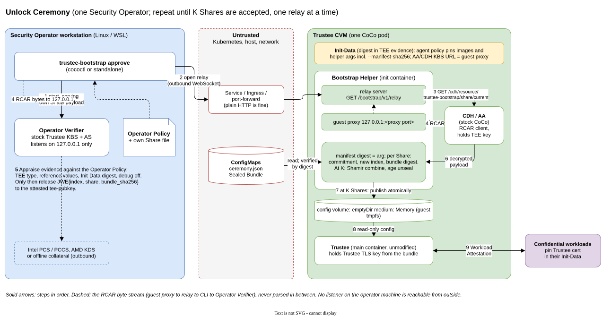
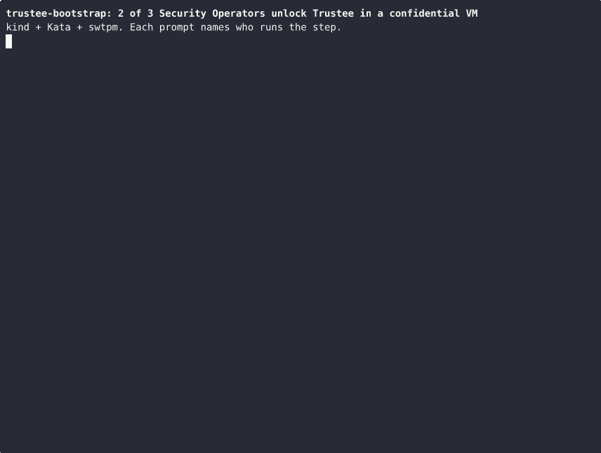

# trustee-bootstrap

trustee-bootstrap lets you run an unmodified [CNCF Trustee](https://github.com/confidential-containers/trustee) inside a confidential VM, the **Trustee CVM**, and unlock it only after K of N **Security Operators** have each checked that VM for themselves. Trustee's whole state, including its TLS key, its policies and its secrets, travels as one encrypted **Sealed Bundle**. The key that opens it exists only as **Shares**, one per Security Operator. Each Security Operator releases their Share only after their own **Operator Verifier** has appraised the CVM through Trustee's standard attestation.

> **Status:** works end to end on swtpm, and CI runs the full ceremony on every PR. The release gate, a run on real TDX, SNP or Azure vTPM hardware ([ticket 17](docs/tickets/17-real-tee-release-gate.md)), is still open. Until it passes, every claim profile is untested. Don't use this for a production unlock.

Terms in **bold** are defined in [`GLOSSARY.md`](GLOSSARY.md).

## How an unlock works



1. Once, on an air-gapped machine, the **Ceremony Authority** runs `ceremony split`. It writes one Share file per Security Operator and a public **Ceremony Manifest**, then forgets the key.
2. The **Infrastructure Operator** runs `seal` on Trustee's config tree, which produces the Sealed Bundle and its digest. They deploy the Trustee CVM: a **Bootstrap Helper** init container, then Trustee itself.
3. Each Security Operator reviews the CVM's Init-Data and runs `policy build`, then `approve`. `approve` starts a local Operator Verifier on `127.0.0.1` and opens a relay to the Bootstrap Helper. The CVM attests through that relay. The Operator Verifier releases the Share only if the evidence matches the operator's own **Operator Policy**.
4. Once K Shares have arrived, the Bootstrap Helper rebuilds the key, unseals the bundle into guest memory, checks that the config is safe, and exits. Trustee starts with the sealed state.

Nothing on the host ever sees a Share, the key or the plaintext config. [`SECURITY_THREAT_MODEL.md`](SECURITY_THREAT_MODEL.md) lists the claims and their limits.

### See it run



Each prompt names who runs the step. The Ceremony Authority splits the key, and the Infrastructure Operator seals the config and deploys the Trustee CVM. Two Security Operators review its Init-Data and approve. Then a workload gets its secret, and a workload with other Init-Data is refused. To watch at your own pace, run `asciinema play docs/demo/unlock-ceremony.cast`. To record it again, run `test/e2e/demo.sh record`.

## Where to start

| You are | Read |
|---|---|
| New to the project | this page, then [`IMPLEMENTATION_SPEC.md`](IMPLEMENTATION_SPEC.md) §0 to §2 and the [ADRs](docs/adr/) |
| A Security Operator | [Unlock Ceremony runbook](docs/runbooks/unlock-ceremony.md), [withdrawing an approval](docs/runbooks/withdraw-approval.md), [claim profiles](docs/claim-profiles.md) |
| The Ceremony Authority | [Key Ceremony runbook](docs/runbooks/key-ceremony.md), [roster change](docs/runbooks/roster-change.md) |
| The Infrastructure Operator | [sealing runbook](docs/runbooks/seal.md), [Trustee upgrade](docs/runbooks/trustee-upgrade.md), the example pod in [`deploy/examples/`](deploy/examples/) |
| A reviewer | [`SECURITY_THREAT_MODEL.md`](SECURITY_THREAT_MODEL.md), then the [tickets](docs/tickets/README.md): each one records what ran and what it deferred. The [evals](docs/evals/README.md) test the threat model's claims against operator mistakes and a hostile host |
| A contributor | [`AGENTS.md`](AGENTS.md), [`docs/ci.md`](docs/ci.md), the [tickets](docs/tickets/README.md) |

## Build and test

You need Go 1.25 or later; the `toolchain` line in `go.mod` selects 1.26.4.

```sh
go build ./cmd/trustee-bootstrap ./cmd/bootstrap-helper
test/e2e/ci.sh go              # go vet, go test, module checks
test/e2e/ci.sh lint main       # golangci-lint, gremlins and jscpd on your changes
```

The end-to-end tests need a Linux host with KVM, sudo and rootful podman. They build a kind cluster with Kata Containers and swtpm, then run the whole ceremony, attacks included:

```sh
test/e2e/ci.sh e2e             # about 20 minutes cold, 6 with the build cache
```

[`docs/ci.md`](docs/ci.md) explains what each CI job runs. [`docs/upstream-pins.md`](docs/upstream-pins.md) lists the exact Trustee, guest-components and Kata versions the tests use.

## Using it from cococtl

`pkg/cli.NewTrusteeBootstrapCmd()` exports the whole command tree. [`docs/cococtl/`](docs/cococtl/) holds a patch that mounts it as `cococtl trustee-bootstrap` and `kubectl coco trustee-bootstrap`. This repo also builds the standalone `trustee-bootstrap` binary.

## Layout

```text
cmd/trustee-bootstrap/   standalone CLI
cmd/bootstrap-helper/    Bootstrap Helper binary and container image
pkg/cli/                 the command tree: ceremony split, seal, policy build, approve, status
pkg/ceremony/            Ceremony Manifest, Share files, split and combine
pkg/seal/                age + tar seal and unseal, safe extraction
pkg/policy/              Operator Policy and claim profiles
pkg/verifier/            Operator Verifier, default secure configs, sealed-config checks
pkg/relay/               relay framing and limits
pkg/helper/              Bootstrap Helper state machine and API
deploy/examples/         example Trustee CVM pod, Init-Data and Trustee config
test/e2e/                kind + Kata + swtpm environment and the end-to-end tests
docs/                    ADRs, runbooks, tickets, evals, claim profiles, pins, CI
```
